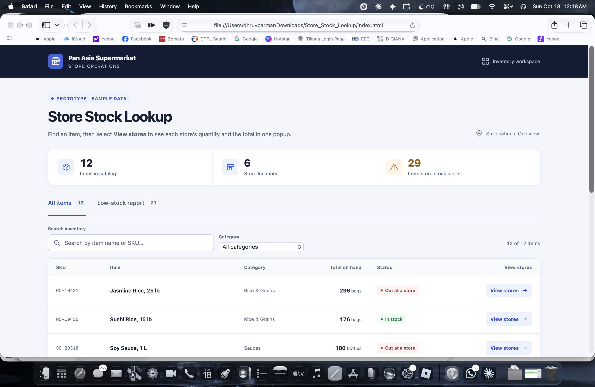

# Store Stock Lookup

A multi-store inventory tool for grocery chains. Pick an item and see how much
is on hand at every store, plus the chain-wide total, in a popup without
leaving the page.

**[Try it live →](https://dhruvprmr.github.io/store-lookup/)** (sample data, nothing to install)

## What it does

- **Stock by store.** Search or filter items, click one, and a popup shows each
  store's quantity, a quick comparison bar, and the chain-wide total.
- **Status at a glance.** Items are flagged In stock, Low, or Out based on each
  store's reorder point.
- **Transfer suggestions.** When a store runs low, it suggests moving stock from
  a store with surplus, without pushing that store below its own reorder point.
- **Low-stock report.** Every item that needs attention, grouped by store.
- **Receive and sell.** Adjust a store's stock and every view updates instantly.
  Overselling is blocked.

## Try this

1. Search **Jasmine** and open it. Kansas City is out.
2. Click **Apply transfer** to move stock from Nashville. The total stays the same.
3. **Receive** 12 bags at Omaha and watch the total and report update.

## How it works

One HTML file with plain JavaScript, no frameworks. All inventory lives in one
`items` array, and every change re-renders the list, report, and popup from it,
so the screens never disagree. The popup is the browser's native `<dialog>`.

The transfer logic (`suggestTransfers`) handles empty stores first, then the
largest shortfalls, and reserves stock as it plans so two suggestions never
promise the same units.

## Taking it to production

This is an in-memory demo, so changes reset on refresh. In a real deployment,
quantities would load from the inventory database or POS API, and every change
would be saved through a server API with permissions and an audit log. A
transfer would update both stores in a single database transaction.

---
Built by Dhruvkumar Parmar
